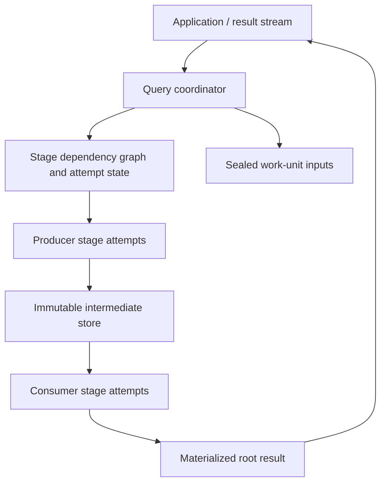

# RFC: Materialized exchanges and query recovery

- Status: Design proposal; no implementation or compatibility promise
- Scope: opt-in recoverable execution within a live query coordinator
- Related: [worker admission and safe retries](0640-worker-admission-and-safe-retries.md)

## Decision

Add a materialized execution mode alongside the existing streaming mode.
Each stage writes immutable intermediate partitions through a user-supplied
store. The query coordinator schedules dependent stages only after accepting
a complete output manifest. Failed execution restarts from these boundaries,
with fresh operator state. The final result is also materialized before it is
exposed to the caller.

This is an execution capability of the library. It requires neither a permanent
scheduler service nor a particular worker deployment, storage service, or
network protocol. Applications may deploy a separate coordinator pool.

The first version uses static plans, blocking exchanges at every distributed
boundary, and conservative stage invalidation. Hybrid streaming/materialized
plans, adaptive replanning, speculative execution, and coordinator failover
are subsequent work.

## User-visible contract

An eligible read-only query can survive retryable task failures and loss of
intermediate outputs while its coordinator remains alive. Recovery is bounded
by attempt budgets, a query-wide recovery budget, and the query deadline.
Exhaustion returns an error, never a partial success.

Execution is at least once. Publication selects one successful output per
logical task within a stage generation. This is not exactly-once execution of
user functions, external requests, session builders, or hooks.

The normal DataFusion result-stream API remains usable: its first batch waits
for final-result commitment. Dropping that stream cancels unfinished work and
releases result retention. A future explicit result handle may offer longer
retention and repeated reads; it is not required for initial recovery.

Coordinator-process loss fails the query in v1. Shared intermediate storage
alone does not restore the plans, source snapshots, accepted attempts, and
ownership needed to resume it. Retrying a whole query after that failure is a
new execution and may observe a different source snapshot.

## Architecture



The coordinator retains unbound stage-plan templates, input dependencies,
source identities, feed assignments, accepted output manifests, and attempt
state. It binds an immutable input manifest to each dispatched attempt.
Workers never discover current inputs by listing storage prefixes.

Stage execution is explicit rather than triggered recursively by a downstream
stream read. A runnable producer executes all of its assigned input partitions
and writes every resulting exchange partition. The coordinator releases its
execution resources after completion; retained files have a separate lifetime.
Independent ready stages may run concurrently within configured admission and
resource limits.

## Placement and coordinator mode

Placement is independent of exchange and recovery modes:

- A shared deployment permits nodes to coordinate queries and accept tasks.
- A separate coordinator pool plans queries, manages recovery, and executes
  the root plan, including final aggregation where the plan places it there.
  Its worker resolver returns only worker-pool addresses.
- Coordinators that must not accept additional worker tasks omit local-worker
  registration. A formal placement policy should also prevent built-in
  colocation rules from placing other stages on that pool.

The root is an explicit recoverable stage, even when executed locally. It uses
the same attempt lifecycle and output-publication rules as a remote stage.
Separating pools does not provide coordinator failover, move every aggregate
to the root, or remove the root's memory and CPU requirements.

## Identities and visibility

Use separate identities for these concepts:

| Identity | Meaning |
| --- | --- |
| Query execution ID | One invocation, not a SQL text or reusable plan ID |
| Stage ID | Stable dependency-graph node |
| Stage generation | Incremented whenever that stage's inputs or outputs are invalidated |
| Logical task ID | Fixed assignment within a stage generation |
| Attempt ID | Fresh opaque ID for each execution attempt |
| Exchange partition ID | Logical output partition read by a consumer |
| Worker incarnation | Distinguishes a restarted worker from its previous process |

An attempt writes to a unique namespace. Its output manifest includes schema,
partitioning and ordering metadata, input-manifest identity, and an entry for
every output partition, including explicitly empty partitions. Each entry
identifies immutable segments, lengths, integrity metadata, and backend-defined
locations. Segment order is explicit; object listing order has no meaning.

A shuffle reader obtains the accepted contribution from each producer task for
its partition. Broadcast readers can independently reopen the same immutable
outputs. Physical implementations may consolidate partitions into indexed files
to avoid one object per producer/consumer pair.

Two distinct transitions must not be called the same commit:

1. **Seal attempt output:** the store finishes writes and returns an immutable,
   reopenable manifest. All referenced bytes must be readable before success.
2. **Accept attempt output:** the coordinator atomically selects that manifest
   for the still-current task and generation. Only accepted manifests can enter
   a stage's published input snapshot.

Sealing does not make an attempt visible to consumers. The coordinator is the
single acceptance authority in v1. No distributed compare-and-swap service is
needed because coordinator failover is excluded. Duplicate completion messages
are idempotent; stale generations and superseded attempts cannot be accepted.
Cancellation fences acceptance immediately, without waiting for remote work to
stop. Physical deletion of abandoned output can happen later.

The whole stage becomes ready for consumers only after every logical task has
an accepted complete output. A task retry may reuse successful sibling outputs
when the stage's input snapshot and generation remain unchanged.

## Intermediate-result store

Introduce a dedicated store extension rather than encode persistence semantics
inside `WorkerChannel`. Channels remain transport; stores own immutable output
creation, reading, retention, and deletion. A local-disk store can use the
application's transport to serve its files remotely.

The conceptual Rust interfaces are deliberately not final signatures:

```text
IntermediateResultStore
  begin_attempt(AttemptDescriptor) -> AttemptWriter
  open_partition(PartitionDescriptor, ReadPosition) -> BatchStream
  release(Manifest) -> Result

AttemptWriter
  write(ExchangePartitionId, RecordBatch) -> Result
  seal() -> AttemptManifest
  abort() -> Result
```

The interfaces must be object-safe, asynchronous where I/O occurs, and support
bounded buffering and cancellation. `seal` consumes the writer logically;
repeated status inspection or reporting must resolve ambiguous acknowledgments.
Backend descriptors need an explicit versioned codec and registered backend ID,
not a Rust trait object on the wire. Readers validate backend, schema, lengths,
and integrity metadata. Locations are scoped to the query's access context.

Store implementations:

| Backend | Survives | Recovery after output loss |
| --- | --- | --- |
| Worker-local files | Task completion, possibly process restart if explicitly supported | Recompute lost producer stage and affected descendants |
| Shared object storage | Worker loss, subject to backend durability | Retry compute elsewhere; reuse accepted files |
| Application-provided store | Its declared guarantees | Same coordinator protocol |

Do not assume atomic directory rename. Seal may write immutable objects followed
by a manifest after all uploads finish. An incomplete upload or unaccepted
manifest is an orphan, not a readable stage output. A local store binds handles
to the worker incarnation unless it explicitly supports reopening after restart.

Configure storage quota, write concurrency, read concurrency, retention, and
orphan cleanup. Keep accepted intermediate files until query completion in v1;
early deletion would remove recovery boundaries. Attempt leases and a janitor
bound leaks after coordinator death. An active reader holds a retention lease;
normal cleanup cannot delete its data. Store-wide outages consume bounded
backoff rather than causing unlimited producer recomputation.

## Replayable work-unit inputs and operator eligibility

The existing `WorkUnit` blanket implementation only guarantees protobuf
serialization. The existing `WorkUnitFeedProvider::feed` contract does not
guarantee repeatable enumeration, stable source contents, or safe side effects.
Do not infer replay safety from either interface.

Add an opt-in replay capability alongside the existing provider interface.
Before dispatching a source stage, enumerate and seal its feed assignments into
a bounded, spillable input journal. Record the original encoded payloads,
partition assignment, sequence, codec identity, and end-of-feed marker. Retries
read that journal; they do not invoke the original provider again. Partial feed
enumeration failure fails preparation in v1 unless the provider explicitly
supports safe restart. Do not start attempts against an unsealed journal.

Each source also supplies or attests to stable input identity: for example,
immutable object versions or a table snapshot. A mutable path or an arbitrary
HTTP request is insufficient. A missing original version fails the query;
recovery must not silently substitute newer data.

Eligibility covers the entire execution path: operators, UDFs, source readers,
session construction, decoding, and rewrite hooks. Built-in supported read-only
paths have documented guarantees; unknown custom paths must opt in. Reject
unsupported plans before executing them when recoverable mode is requested.
Do not silently downgrade to streaming execution.

Freeze query-level constants and replay-relevant configuration. Disallow
uncontrolled nondeterministic functions and external side effects in v1.
Replay need not be byte-identical where SQL permits ordering differences, but
it must preserve the query's semantic contract, including required ordering.
Retries reconstruct fresh execution state from retained templates/codecs;
cloning an `Arc<dyn ExecutionPlan>` is not a reset of stateful operators.

## Recovery state machine

```text
Stage: WaitingForInputs -> Ready -> Running -> Complete
                                  |              |
                                  +-> Invalidated <-+
                                         |
                                  new generation

Attempt: Admitting -> Executing -> Sealed -> Accepted
                        |            |
                        +-> Failed / Superseded / Cancelled
```

Classify failures with structured, transport-independent information:

| Failure | Action |
| --- | --- |
| Admission rejected or safely interrupted | Existing admission retry policy |
| Retryable execution/worker failure, inputs intact | Fence attempt; run a fresh attempt of that task |
| Lost or corrupt accepted intermediate output | Invalidate producer generation and its transitive descendants; rebuild from intact ancestor boundaries |
| Transient store read failure | Bounded retry; no partial-batch replay into a live operator |
| Permanent source/version loss, invalid plan, deterministic computation error | Fail query |
| Cancellation, deadline, budget exhaustion | Fence all attempts and terminate |

For v1, losing any accepted output invalidates its entire producer stage and
all dependent stages, including completed descendants. This costs more than
partition-level repair but prevents combining results from inconsistent input
generations. Unaffected branches remain reusable. Later optimization may repair
individual lost partitions only with a precise consistency contract.

Invalidation first fences affected generations and unpublishes their manifests,
then cancels attempts and constructs new generations. A downstream attempt reads
a fixed input manifest and never switches it midway. Status and metrics from
obsolete attempts cannot complete the replacement generation.

### The half-aggregated case

1. Stage B reads accepted stage A files and builds half an aggregate.
2. An input is lost. B reports its exact input manifest and failed location.
3. The coordinator invalidates A and dependent B, fencing both generations.
4. B's aggregate state and provisional output are discarded.
5. A is recomputed from its sealed source feed or intact upstream manifests.
6. B is rebuilt with an empty aggregate and reads the new complete A manifest.

No replayed batch enters B's old aggregate. B's obsolete successful siblings,
if any, also cannot contribute to the new stage result.

### Ambiguous completion

If a worker seals output but its completion response is lost, the coordinator
may accept a later report only while that attempt remains current. It can also
fence the attempt and retry under a fresh identity. Both outputs can exist, but
only the selected one is visible. This relies on replay-safe execution and does
not authorize duplication of arbitrary external side effects.

## Final-result commitment and delivery

Materialize all root partitions and accept one complete final manifest before
returning any rows. Before that point, root failure follows ordinary stage
recovery. Do not restart `DistributedExec::execute` around a partially delivered
result stream.

After delivery starts, freeze the final manifest. A reader may reopen the same
immutable segment at an exact validated batch/row position, advancing its cursor
only after handing a complete batch to its caller. It must not replay from the
beginning into that caller. If the backend cannot support safe resume, return
an error on interrupted delivery. Partial network frames are never batches.

If accepted final files are permanently lost after delivery starts, fail the
stream; v1 does not recompute a possibly different result and splice it into
already delivered rows. Use a shared durable result store when results must
survive loss of the node that computed them. Intermediate and final stores may
be configured separately. Application/network delivery acknowledgments beyond
the library's stream boundary are the host application's responsibility.

## Interaction with existing features

- **Admission RFC:** reuse reservations and attempt identity. Its rule that
  post-`SetPlanRequest` failures are fatal remains valid for legacy streaming
  execution. Materialized execution explicitly opts into repeatable execution
  and fenced output publication. Admission commitment and output acceptance
  are different transitions.
- **Static preparation:** retain logical templates before URL binding. Add a
  materialized stage scheduler alongside `prepare_static_plan`; its dispatch
  occurs when dependencies are complete rather than preparing all stages for
  recursive streaming execution.
- **Planner:** preserve ordinary single-node executability of preparatory
  rewrites. Do not add topology rewrites to `inject_network_boundaries`.
  Implement materialized writer/reader nodes under `execution_plans` and their
  codecs under `codec`.
- **Routing/events:** reuse routing and admission policy. Add lifecycle events
  only for application policy; output acceptance and fencing are mandatory
  correctness rules that handlers cannot bypass.
- **AQE:** initially reject materialized mode with adaptive execution enabled.
  Later, replan only at committed boundaries with a new plan/generation identity.
- **Dynamic filters:** initially disable cross-stage runtime dynamic filtering
  explicitly in this mode and report it in explain output. Later filters must
  be tied to producer generations and invalidated with them. Existing local
  filters are allowed only within supported replay-safe operator lifetimes.
- **Connection/task caches:** keys must include attempt and generation wherever
  they currently assume a `TaskKey` identifies one execution. Also rebuild
  worker-local feeds, metrics, and runtime state per attempt.
- **Protocol:** completion carries sealed output descriptors and input identity;
  failures identify phase and affected manifest; cancellation is attempt-scoped.
  Negotiate materialized-execution and store-codec capabilities before dispatch.

No public or wire-format breaking changes are made by this RFC. Implementation
must use additive extension points where possible. Any unavoidable breaking
change targets an explicitly approved major release with a migration entry
derived from the latest release tag. Never reinterpret legacy messages or
silently fall back when a worker lacks the requested capability.

## Observability and validation

Explain shows exchange mode, stage boundaries, placement, replay eligibility,
and disabled optimizations. Runtime metrics distinguish logical results from
all attempts: retries by reason, generations invalidated, bytes materialized,
bytes reread, retained bytes, orphan cleanup, and time waiting on dependencies.
User errors preserve the original DataFusion error plus task/attempt context.

Use one integration-test file for recovery through the normal public planning
and execution path, with separately named scenarios:

1. Worker failure midway through output writing: no provisional output consumed.
2. Failure after sealing but before completion acknowledgment: one accepted result.
3. Consumer failure after partial aggregation: fresh state, exact expected values.
4. Lost accepted output with active/completed descendants: generation invalidation,
   no stale partial outputs, unaffected branch reused.
5. Stale success after cancellation or reassignment: never accepted.
6. Stateful feed enumeration: invoked once, replay preserves original assignments.
7. Source-version disappearance or unsupported custom operator: explicit failure.
8. Root failure before commitment: retry succeeds without exposing earlier rows.
9. Final read interrupted after some rows: exact resume or explicit error, no duplicates.
10. Retry budget exhaustion and stream drop: bounded work and eventual cleanup.

Add focused store conformance tests for empty partitions, seal visibility,
independent readers, corrupt/truncated segments, and retention races. Keep
small state-machine tests next to acceptance/invalidation logic. Fault injection
must target deterministic lifecycle points, not probabilistic timing alone.
Plan/assignment snapshots should show the contract alongside result assertions.

## Delivery sequence

1. Agree on eligibility, identities, acceptance, and final-delivery guarantees.
2. Add immutable store interfaces and a shared-store implementation with bounded
   Arrow IPC segments; validate its conformance independently of scheduling.
3. Add opt-in materialized planning/execution, sealed input journals, and final
   materialization without retries. Prove results match supported streaming plans.
4. Add attempt retry and generation fencing, then lost-output invalidation.
5. Add a worker-local store, remote file serving, and explicit placement policy.
6. Qualify resource use and performance before any performance claim. Only then
   consider finer-grained repair, AQE, mixed exchanges, or persisted coordinator state.

The shared-store-first order reduces simultaneous protocol changes; the store
contract still includes worker-local loss from the start. The default execution
mode remains streaming.

## Decisions still requiring implementation experiments

- Arrow IPC segment/index sizing and the exact reader resume token.
- How custom plan providers declare replay safety without an overly broad
  global assertion that silently covers unrelated extensions.
- Store registry and manifest codec integration with existing session codecs.
- Root placement API: explicit policy versus a documented deployment preset.
- Retry/retention default budgets and whether source journals share the output
  store implementation or a narrower byte-storage abstraction.

## Evidence and boundaries

The current implementation already has query and stage coordinators, but its
worker-message error path fails the query and feed providers have no replay
contract. See `src/coordinator/query_coordinator.rs`,
`src/coordinator/prepare_static_plan.rs`, and
`src/work_unit_feed/work_unit_feed_provider.rs`.

Ballista is a useful reference for blocking recovery: its
[stage rollback](https://github.com/apache/datafusion-ballista/blob/c1de8e5b15604bce4800f5e396cd42a97ccee06b/ballista/scheduler/src/state/execution_graph.rs#L1425)
discards stage outputs, and its tests exercise partial-output invalidation.
This proposal chooses its own conservative generation policy; it does not
claim identical Spark or Ballista implementation semantics.
